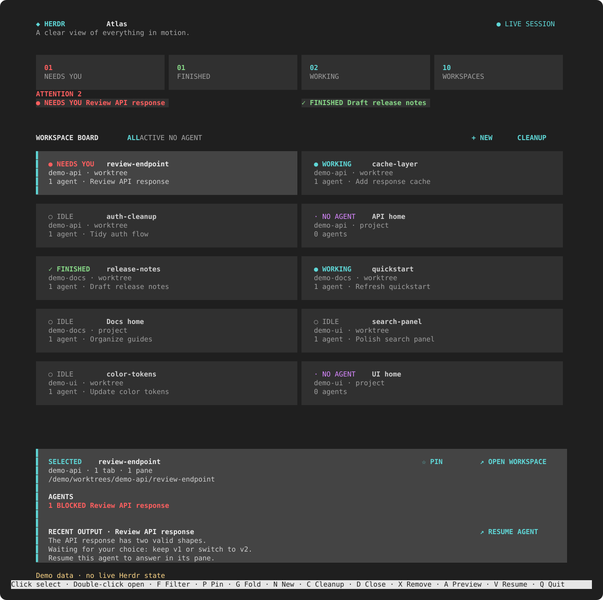

# Herdr Atlas

**Your Herdr workspaces, worktrees, and agents on one screen.** Spot what needs you, jump back into a session, and keep worktrees tidy from a full-screen desk.



*Demo preview generated from [fictional data](tools/render_demo.py). No live workspaces, repositories, or agent output appear in the image.*

## Quick start

Requires Herdr 0.9.0 or later and Python 3 on macOS or Linux.

```sh
git clone https://github.com/DominykasBartauskas/Herdr-Atlas.git
cd Herdr-Atlas
herdr plugin link .
herdr plugin pane open --plugin sacrive.herdr-atlas --entrypoint desk
```

## What you can do

- **Spot what needs you.** The attention queue surfaces blocked and finished agents. The board groups workspaces by repository, with search, filters, and persistent pins.
- **Jump back into work.** Preview an agent's recent output, then focus its pane directly from the board.
- **Create and clean up worktrees.** Create a branch and Herdr workspace together. Find linked worktrees with no live agent, close or remove them, and reopen closed checkouts. Removal requires confirmation and uses Herdr's non-forced command, which rejects dirty checkouts.

## Controls

| Action | Mouse | Keyboard |
| --- | --- | --- |
| Select or open a workspace | Click or double-click its card | Arrows or `h` `j` `k` `l`; `Enter` to open |
| Filter, search, pin, or fold | Click filter or pin controls | `f`, `/`, `p`, `g` |
| Preview or resume an agent | Click an agent or Resume | `a` to cycle, `v` to resume, `1`–`4` to jump |
| Create a worktree | Click **+ New** | `n` |
| Open Cleanup | Click **Cleanup** | `c` |
| Close or remove a worktree | Click the action in Cleanup | `d` to close, `x` to remove |
| Refresh or quit | — | `r`, `q` |

Atlas reads Herdr's local CLI and event socket, with a five-second fallback refresh. Pins are stored in Herdr's plugin state directory. Historical sessions that Herdr has already closed are outside the live agent preview.
